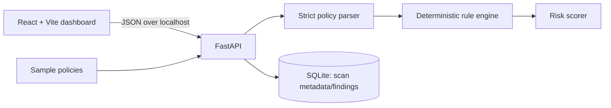

# CloudSentinel

> **See the risk. Understand the exposure. Secure your cloud.**

CloudSentinel is a local-first AWS IAM policy document analyser for developers and security reviewers. It parses policy JSON without executing it, applies deterministic security rules, and returns evidence-backed findings with a transparent prioritisation score.

It is a DevForge 2026 portfolio project. It does **not** connect to AWS accounts, scan live infrastructure, certify security, or guarantee detection of every policy issue.

## Why it matters

IAM policies are deceptively compact. A wildcard action, broad `PassRole`, or policy-version combination can have far-reaching effects. CloudSentinel turns those patterns into readable evidence and recommendations before policies are deployed.

## Features

- Strict parser for IAM policy structure, `Action`/`Resource` strings or arrays, `NotAction`, `NotResource`, `Condition`, and statement effects.
- Ten explainable detections, statement index/Sid evidence, matched actions/resources, remediation, confidence and heuristic labels.
- Deterministic risk score capped at 100, SQLite-backed scan history, sample-policy library, JSON/print reports.
- React dashboard with local API health, empty states, severity chart, policy explorer, history, and responsive security-SaaS styling.
- No API keys, AWS account, uploaded-code execution, or raw-policy persistence.

## Architecture



## Rules

| Rule | Detection | Default severity |
|---|---|---|
| IAM-001 | `Action: "*"` | Critical |
| IAM-002 | Sensitive IAM actions on broad resources | High/Critical |
| IAM-003 | Broad `iam:PassRole` | Critical |
| IAM-004 | Policy version creation + activation | Critical |
| IAM-005 | Broad role-policy modification | High |
| IAM-006 | Broad access-key creation | High |
| IAM-007 | Sensitive IAM actions without recognised restrictive conditions | Medium |
| IAM-008 | Service wildcard action, e.g. `s3:*` | High |
| IAM-009 | `NotAction`/`NotResource` in an Allow statement | Medium |
| IAM-010 | Constructs the tool cannot confidently evaluate | Informational |

## Risk methodology

Critical findings add 30 points, High 20, Medium 10, Low 5, Informational 0. The sum is capped at 100. `0–19` is Low, `20–39` Moderate, `40–69` High, and `70–100` Critical. This is a transparent heuristic for prioritisation, not an AWS-certified score or exploitability conclusion.

## Run locally

Prerequisites: Python 3.11+ and Node 20+ with pnpm (or adapt commands for npm).

```powershell
cd backend
python -m venv .venv
.\.venv\Scripts\python -m pip install -r requirements.txt
.\.venv\Scripts\uvicorn app.main:app --reload --port 8000
```

In another terminal:

```powershell
cd frontend
pnpm install
pnpm dev
```

Open `http://localhost:5173`. FastAPI Swagger is available at `http://127.0.0.1:8000/docs`.

## API

- `GET /api/health` — service state
- `POST /api/analyze` — validate/analyse a policy and save scan metadata
- `GET /api/scans`, `GET /api/scans/{scan_id}`, `DELETE /api/scans/{scan_id}`, `DELETE /api/scans`
- `GET /api/samples`, `GET /api/samples/{name}`
- `GET /api/rules`

The request body is `{ "policy": { ... }, "policy_name": "optional.json" }`; the body limit is 256 KB. Raw policies are never saved by the backend.

## Samples and tests

The `sample_policies/` folder contains an intentionally critical administrator policy, a moderately risky policy, and a scoped read-only example. The UI loads each as actual JSON and submits it to the normal API.

```powershell
cd backend; .\.venv\Scripts\python -m pytest -q
cd ..\frontend; pnpm run build
```

Backend tests cover parser failures, positive/negative rule behavior, scoring, API validation, and the database scan lifecycle. The production frontend build runs TypeScript checks.

## Limitations and roadmap

CloudSentinel does not calculate AWS’s full effective permission model: it does not resolve identities, SCPs, permission boundaries, resource policies, runtime context, or all condition semantics. `NotAction`, `NotResource`, principals, and unknown fields are surfaced as heuristic/manual-review signals. Follow up important findings with AWS IAM Access Analyzer and organisational review.

Future work: condition semantics expansion, ruleset versioning, SARIF export, local encryption for history, and policy comparison.

