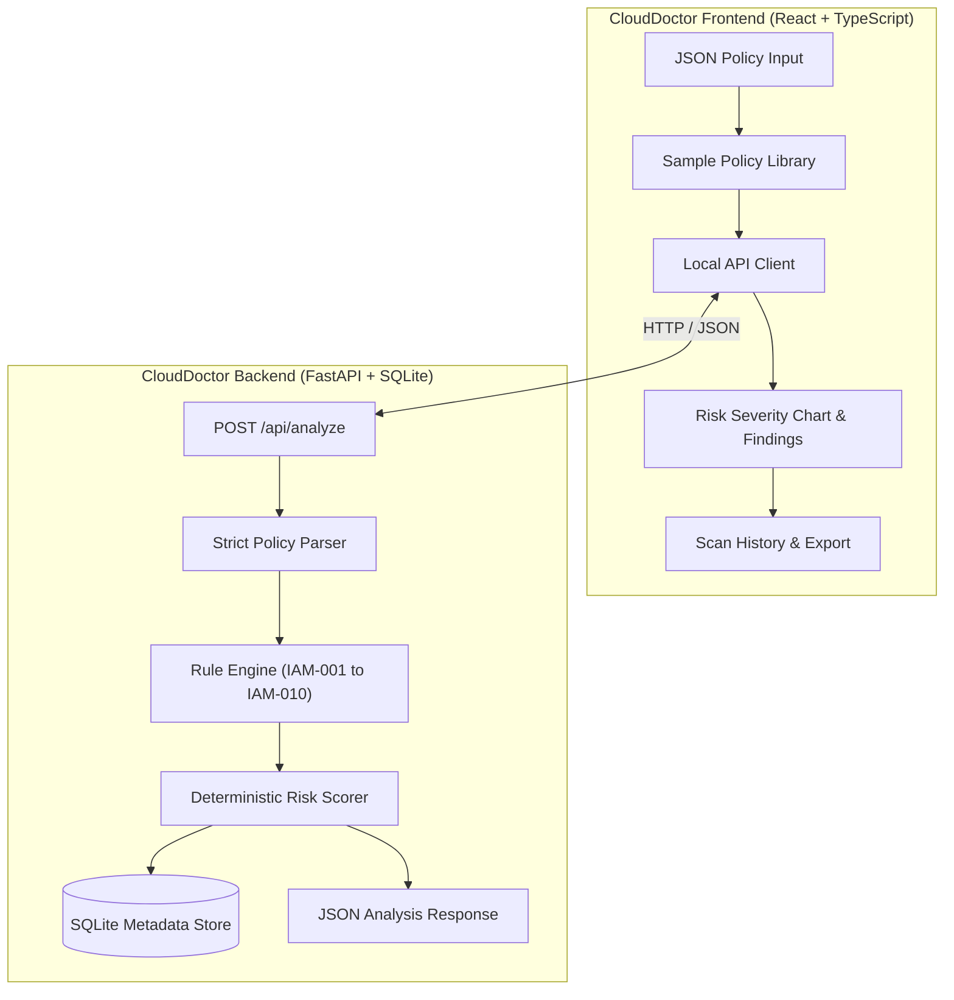

# CloudDoctor

> **See the risk. Understand the exposure. Secure your cloud.**

[](https://github.com/shashankedu02/CloudDoctor/actions/workflows/ci.yml)
[](LICENSE)
[](https://www.python.org/downloads/)

**CloudDoctor** is a local-first AWS IAM policy document analyser designed for developers, DevOps engineers, and security reviewers. It parses policy JSON documents without executing them, applies deterministic security rules, and returns evidence-backed findings with a transparent prioritisation risk score (0–100).

It is a portfolio engineering project built for security review workflows. It runs strictly offline on your local machine and does not connect to AWS accounts, scan live infrastructure, or store policy payloads.

---

## Why It Matters

AWS Identity and Access Management (IAM) policies are deceptively compact. A wildcard action, broad `iam:PassRole`, or unsafe policy version combination can grant unintended privilege escalation paths. 

**CloudDoctor** turns those complex permission patterns into readable evidence, risk severity breakdowns, and actionable remediation guidelines before policies are deployed to production.

---

## Key Features

- **Strict IAM Document Parser:** Handles IAM policy structure, single strings vs. arrays for `Action` and `Resource`, `NotAction`, `NotResource`, `Condition` blocks, and `Effect` (`Allow` vs. `Deny`).
- **10 Explainable Rules:** Flag privilege-escalation patterns with matched action/resource evidence, statement IDs (`Sid`), remediation steps, and heuristic confidence tags.
- **Deterministic Risk Scoring:** Scores each policy deterministically from 0 to 100 with clear severity thresholds (Low, Moderate, High, Critical).
- **IAM Wildcard Matching:** Action patterns are matched the way IAM evaluates them (case-insensitive `*` and `?`), so `iam:Pass*`, `iam:*Role*` and `*` are all recognised as granting `iam:PassRole`.
- **Local-First & Privacy Preserving:** No AWS API keys, no external network calls (the UI loads no remote fonts or scripts), no cloud telemetry, and raw policy text is never written to the database (covered by a test).
- **Interactive Security Dashboard:** Modern React + TypeScript interface featuring scan history, sample policy library, severity visualizer, and policy inspector.
- **Audit Reports:** Export scan results to JSON or formatted printable summaries.

---

## Architecture



---

## Detection Rules

| Rule | Detection Target | Default Severity | Description |
| :--- | :--- | :---: | :--- |
| **IAM-001** | Full Administrative Wildcard (`*`) | **Critical** | Flags `Action: "*"` (or `"*:*"`) in any Allow statement, whatever its resource scope. |
| **IAM-002** | Sensitive Actions on Broad Resources | **High / Critical** | Detects high-privilege IAM mutations on unconstrained targets. |
| **IAM-003** | Broad `iam:PassRole` | **Critical** | Catches `iam:PassRole` without restrictive resource ARNs. |
| **IAM-004** | Policy Version Creation & Activation | **Critical** | Detects permission to create and set new default policy versions. |
| **IAM-005** | Role Policy Attachment & Mutation | **High** | Identifies permission to attach inline policies to existing roles. |
| **IAM-006** | Access Key Creation | **High** | Flags unauthorized generation of user credentials. |
| **IAM-007** | Sensitive Actions Missing Condition Blocks | **Medium** | Flags administrative privileges lacking MFA or IP restrictions. |
| **IAM-008** | Service Wildcards (e.g., `s3:*`, `iam:*`) | **High** | Surfaces broad wildcard grants within specific cloud services. |
| **IAM-009** | `NotAction` / `NotResource` in Allow Statements | **Medium** | Highlights dangerous inverted permission logic. |
| **IAM-010** | Unparseable / Non-standard Constructs | **Informational** | Flags syntax or structures requiring manual human review. |

---

## Risk Methodology

Findings contribute deterministically to a cumulative risk score capped at **100**:
- **Critical:** +30 points
- **High:** +20 points
- **Medium:** +10 points
- **Low:** +5 points
- **Informational:** +0 points

| Score Range | Risk Level | Action Required |
| :---: | :---: | :--- |
| **0 – 19** | **Low** | Routine review; standard least-privilege alignment. |
| **20 – 39** | **Moderate** | Minor tightening recommended before deployment. |
| **40 – 69** | **High** | Review required; reduce wildcards and constrain resource ARNs. |
| **70 – 100** | **Critical** | Block deployment; privilege escalation or admin wildcard detected. |

---

## Getting Started Locally

### Prerequisites
- Python 3.11+
- Node.js 20+ and pnpm (or npm)

### 1. Backend Setup
```bash
cd backend
python -m venv .venv

# On Windows:
.\.venv\Scripts\activate
# On macOS/Linux:
source .venv/bin/activate

pip install -r requirements.txt
uvicorn app.main:app --reload --port 8000
```
FastAPI Swagger documentation will be available at: `http://127.0.0.1:8000/docs`

Scan metadata is stored in `backend/clouddoctor.db`. Set `CLOUDDOCTOR_DB_PATH` to use a different file.

### 2. Frontend Setup
In a separate terminal:
```bash
cd frontend
pnpm install
pnpm dev
```
Open `http://localhost:5173` to launch the **CloudDoctor** dashboard.

---

## API Reference

| Method | Endpoint | Description |
| :--- | :--- | :--- |
| `GET` | `/api/health` | Healthcheck and engine status |
| `POST` | `/api/analyze` | Evaluates IAM policy JSON and returns structured findings |
| `GET` | `/api/rules` | Retrieves descriptions and severities for rules IAM-001–010 |
| `GET` | `/api/samples` | Lists pre-loaded safe, moderate, and critical test policies |
| `GET` | `/api/scans` | Returns metadata list of previous local scans |
| `DELETE` | `/api/scans/{id}` | Removes a specific scan record from local history |

*Note: Policy payload maximum limit is 256 KB. Raw policy text is never stored in SQLite; only finding metadata and scores are retained.*

---

## Testing & Quality

Run backend lint and tests (each test uses its own temporary database, so your scan history is never touched):
```bash
cd backend
ruff check . && ruff format --check .
pytest -v
```

Run frontend type checks and production build:
```bash
cd frontend
pnpm run build
```

GitHub Actions runs all of the above on every push to `main` and on every pull request (`.github/workflows/ci.yml`).

---

## Limitations & Roadmap

- **CloudDoctor** focuses on static IAM policy analysis and does not resolve live AWS SCPs, resource-based policies, or runtime permission boundaries.
- Each Allow statement is checked on its own. `Deny` statements are skipped, so an Allow that another statement denies is still reported; the score can overstate risk for such policies.
- A resource counts as "broad" only when it is `"*"`, missing, or expressed with `NotResource`. Wildcard ARNs such as `arn:aws:iam::*:role/*` are not yet treated as broad, so findings that depend on broad scope (IAM-002, -003, -005, -006) can be missed for them.
- Condition checks only recognise a fixed list of restrictive keys (IAM-007); they do not evaluate condition values.
- The score is a prioritisation heuristic, not a measure of exploitability.
- **Planned Roadmap:**
  - [ ] SARIF report export for GitHub Actions CI/CD pipelines
  - [ ] AWS IAM Access Analyzer cross-verification adapter
  - [ ] Side-by-side policy diff and permission regression analyzer
  - [ ] Rule customization via local YAML configuration

---

## License

Distributed under the **MIT License**. See `LICENSE` for details.
